# Job Tracker on AWS

A full-stack job-application tracker (**Next.js · Node.js/Express · PostgreSQL**) deployed on AWS with a **custom VPC**, **ECS Fargate behind an Application Load Balancer**, **RDS in isolated private subnets**, **Secrets Manager**, and **least-privilege IAM**, all defined in **Terraform**.

I built this to learn and demonstrate cloud implementation, end to end, on a budget of about $1. This README covers what I built, how I got there, and what broke along the way.

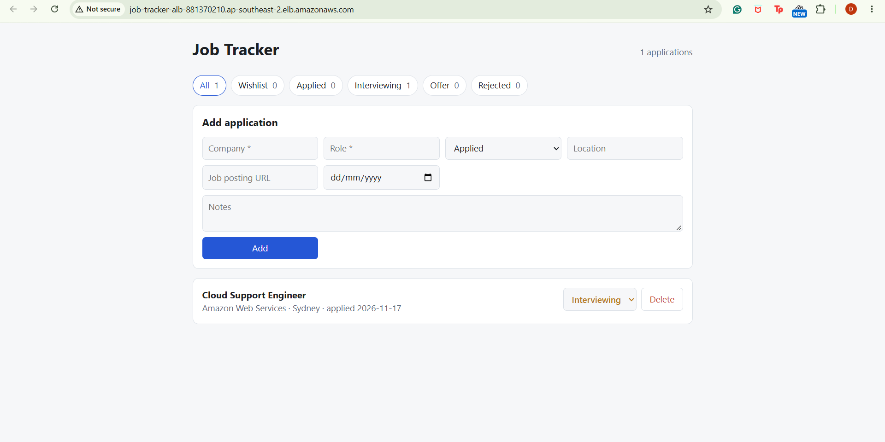

## At a glance

- **The database is never exposed to the internet.** It has no public IP, sits in subnets with no route out of the VPC, and accepts connections only from the backend's security group. I tested this from my laptop: the connection times out.
- **No secrets in code, Git, or Terraform state.** RDS generates the database password and stores it in Secrets Manager. ECS injects it into the container at startup.
- **Each service has only the permissions it needs.** Each ECS service has its own execution role scoped to its own image and log group. The roles the app code itself runs as have **no permissions at all**.
- **Infrastructure as code, split by cost.** A free, permanent *foundation* layer, plus a billable *runtime* layer I create for a session and destroy afterwards. Running this design 24/7 would cost about **$110/month**; mine costs about **$0.09 per hour of demo time**.
- **Real problems, really fixed.** A CRITICAL CVE caught by ECR scanning before deploy, a permissions bug that only appeared in production (diagnosed from CloudWatch Logs), and AWS organization guardrails that changed my CI design.

---

## Architecture

```
                        Internet
                           | HTTP :80
          +----------------v------------- public subnets (2 AZs) ------+
          |  Application Load Balancer                                 |
          |    /api, /api/*    -> backend target group                 |
          |    everything else -> frontend target group                |
          |  NAT instance (outbound only, for private tasks)           |
          +-------+---------------------+---------------^--------------+
                  | :3000               | :4000         | HTTPS out only
          +-------v-------+     +-------v-------+       |
          | frontend task |     | backend task  +-------+   private-app subnets
          |  (Fargate)    |     |  (Fargate)    |
          +---------------+     +-------+-------+
                                        | :5432, TLS (certificate verified)
                                +-------v-------+
                                | RDS Postgres  |           private-db subnets
                                +---------------+           (NO internet route)

  Images: ECR · Secrets: Secrets Manager (injected by ECS) · Logs: CloudWatch
```

| Layer | What's in it | Cost |
|---|---|---|
| `infra/foundation` | VPC (10.0.0.0/16), 6 subnets in 3 tiers × 2 AZs, route tables, S3 gateway endpoint, security groups, ECR repositories, IAM roles, CloudWatch log groups | **$0**, kept permanently |
| `infra/runtime` | NAT instance, RDS PostgreSQL 17, ALB, ECS cluster, task definitions, services | **~$0.09/hr**, created and destroyed per session |

**Security group chain** (each rule references another security group, never an IP range, except the ALB's public port):

| Group | Inbound | Outbound |
|---|---|---|
| ALB | 80 from internet | 3000 → frontend, 4000 → backend |
| Frontend | 3000 from ALB only | 443 to AWS APIs via NAT |
| Backend | 4000 from ALB only | 5432 → database, 443 to AWS APIs via NAT |
| **Database** | **5432 from backend only** | **none** |

---

## The journey

### 1. Feasibility: can this cost $0–1?

The brief I set myself was a custom VPC, ECR + ECS Fargate behind an ALB, RDS that is never public, Secrets Manager, and least-privilege IAM. Priced as an always-on deployment in Sydney, that's about **$110/month**. The biggest item is a managed **NAT Gateway (~$43/month)**, followed by the ALB, RDS and Fargate, all of which bill per hour whether or not anyone uses the app.

That led to the core decisions:
- Develop locally for free.
- Define everything in Terraform so it can be created and destroyed on demand.
- Replace the NAT Gateway with a tiny **NAT instance**.
- Use **Fargate Spot**.
- Keep everything that's free in a separate layer that never gets torn down.

My AWS account is on AWS's **Free plan** ($100 in credits), which also comes with organization guardrails, as I found out later.

### 2. Local first: app + Docker Compose

I built the API (Express 5, input validation, parameterized SQL, an idempotent schema migration guarded by a Postgres advisory lock) and the Next.js UI. Docker Compose runs Postgres, the API and the frontend together.

- **Problem:** `docker compose up` failed because port 5432 was taken by a PostgreSQL install already on my machine.
- **Fix:** stop publishing the database port at all. The API reaches Postgres over Compose's internal network, which mirrors the private-subnet design.

### 3. Foundation network (Terraform)

- 3 subnet tiers across 2 Availability Zones.
- Only the public route table has a route to the Internet Gateway.
- **The private-db route table has no route beyond the VPC.** Even with a misconfigured security group, there's no path between the database and the internet.
- A free S3 gateway endpoint lets ECR image layers download without going through the NAT.
- The VPC's default security group is stripped of all rules.

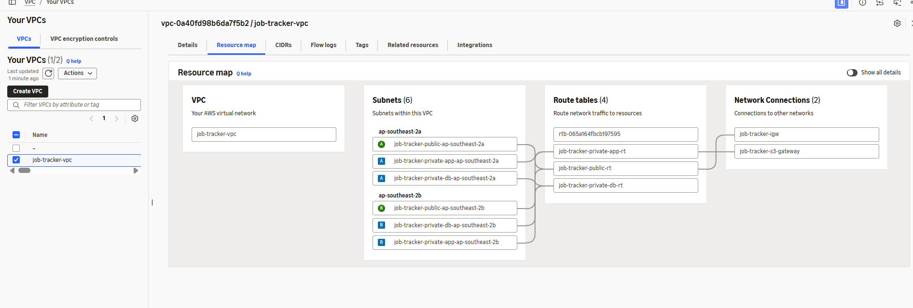
*The public route table connects to the Internet Gateway and the private-app table to the S3 gateway endpoint. The private-db table connects to nothing.*

### 4. ECR and IAM, and hitting AWS's guardrails

- ECR repositories use **immutable tags** (every image is tagged with its Git commit SHA), **scan on push**, and a lifecycle policy that keeps the newest 5 images.
- **Two IAM roles per service:**
  - The *execution role*, used by ECS to pull the image, write logs and read the secret, is scoped to that service's own repository and log group.
  - The *task role*, used by the app code, is deliberately empty.
  - Trust policies include `aws:SourceAccount` / `aws:SourceArn` conditions for confused-deputy protection.

I planned keyless CI with **GitHub Actions OIDC**, and creating it failed. The account's managed **service control policy denies `iam:*Provider*`**. Rather than fall back to a long-lived access key stored in GitHub, I push images from a script that uses short-lived `aws login` credentials. GitHub Actions still runs tests, builds, `terraform validate`, and Docker builds, with no AWS access at all.

Verifying the roles taught me how AWS evaluates permissions. The IAM policy simulator showed *explicit denies* everywhere until I supplied `aws:RequestedRegion` and the organization IDs. Every request has to be allowed by the IAM policy **and** the SCP **and** the resource control policy. With the right context, the results matched the design: each role can pull only its own image, can't push, can't read secrets by default, and the task roles can do nothing.

### 5. Getting images into ECR on Windows

Pushing the first images took four fixes:

| Symptom | Cause | Fix |
|---|---|---|
| `400 Bad Request` from `docker login` | Windows PowerShell 5.1 alters text piped between programs | Skip `docker login`; write the auth entry into a throwaway Docker config |
| "The stub received bad data" | Windows Credential Manager can't hold the ~4 KB token from `aws login` sessions | Same throwaway config, deleted in a `finally` block so the token never lingers |
| ECR scan "not found" | Docker Desktop pushed an *image index* with provenance attestations, which basic scanning skips (and the "expire untagged" rule could orphan the real image) | `--provenance=false --sbom=false` |
| **1 CRITICAL CVE** (CVE-2026-4738, zlib) in both images | Inherited from `node:22-alpine`, which hadn't picked up Alpine's patch yet | `apk upgrade --no-cache` in the runtime stage. Re-scan: **0 findings**, before anything was deployed |

### 6. First deploy: two failures, two fixes

**Failure 1: the Free plan rejected the NAT instance.** The apply stopped partway with `InvalidParameterCombination: instance type is not eligible for Free Tier`. The Free plan only launches certain instance types, so I switched from `t4g.nano` to `t4g.micro`. Terraform's state meant the re-apply created only the missing resources.

**Failure 2: the backend crashed on startup.** The frontend went healthy, but the backend never did. I followed the evidence:
1. **ECS service events:** *"deployment circuit breaker: tasks failed to start"*. The circuit breaker stopped the bad deployment after 5 attempts instead of looping forever.
2. **The stopped task:** `EssentialContainerExited`, exit code 1.
3. **CloudWatch Logs:** `EACCES: permission denied, open '/app/certs/rds-global-bundle.pem'`.
4. **Inside the image:** `/app/certs` had mode `drw-r--r--`.

**Root cause:** `ADD --chmod=644` applied 644 to the directory it created as well as the file, removing the directory's execute bit, so the non-root `node` user couldn't open the certificate. It never showed up locally, because local development doesn't use TLS to the database, which was a lesson in what happens when dev and prod differ.

**Fix:** set the permissions explicitly, and add `RUN test -r …` *as the non-root user*, so this mistake now fails the **build** instead of the deployment.

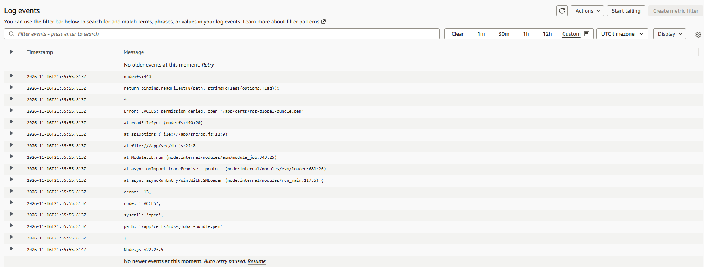
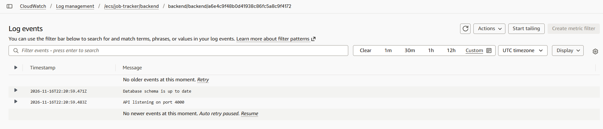

### 7. Verified, documented, destroyed

With the fix deployed, both target groups were healthy and the full path worked: browser → ALB → `/api` rule → backend → RDS over verified TLS. The database hostname resolved to a private `10.0.21.x` address, and a TCP connection from my laptop timed out, which is the expected result. I captured the evidence below, then ran `terraform destroy` on the runtime layer.

---

## Evidence

| | Screenshot | What it proves |
|---|---|---|
| ECS | 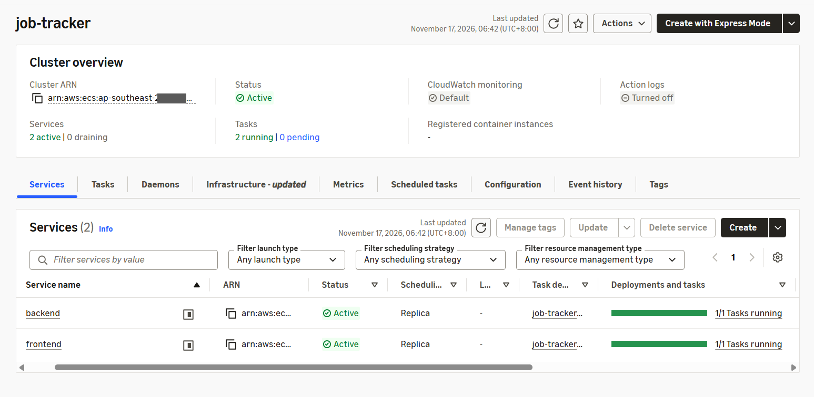 | Both services on Fargate, 1/1 tasks running |
| ALB | 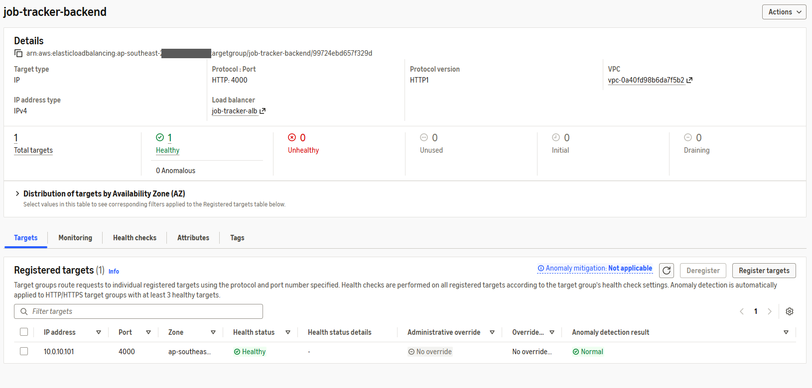 | The backend task (private IP `10.0.10.x`, private-app subnet) passes ALB health checks |
| RDS network | 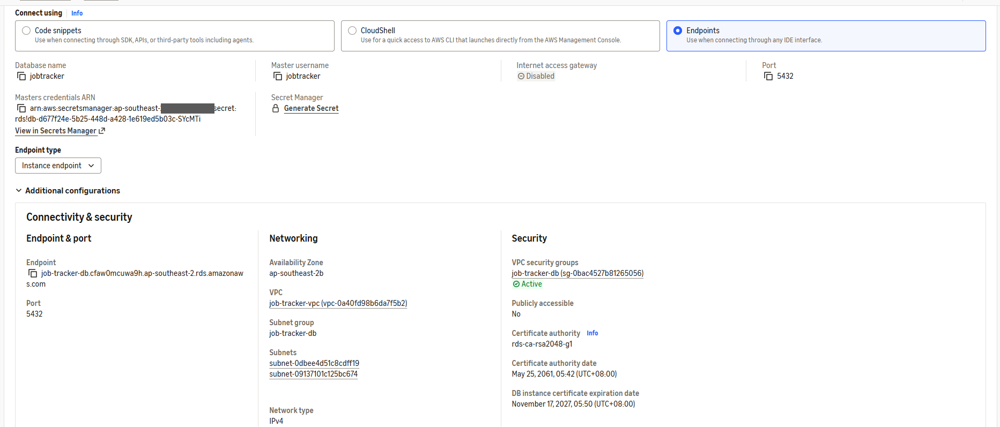 | **Publicly accessible: No**, private-db subnet group, no internet gateway |
| RDS config | 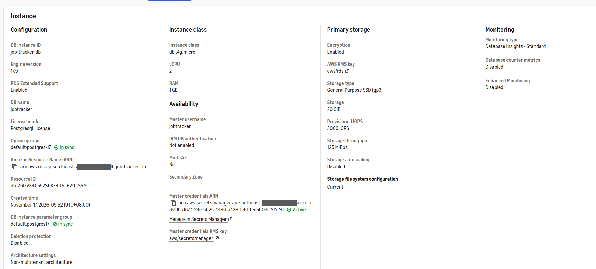 | Encrypted at rest (KMS); master password managed in Secrets Manager |
| Secret | 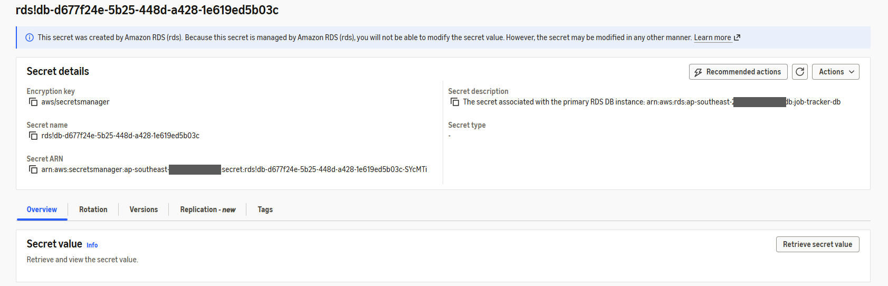 | Created and owned by RDS, encrypted with KMS. The value is never displayed; ECS reads it at task start |
| DB firewall | 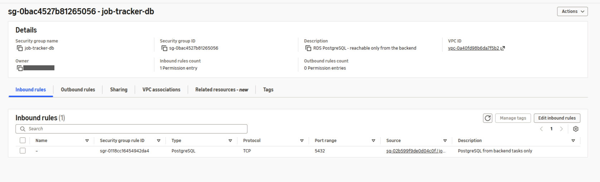 | **1 inbound rule** (5432 from the backend's security group only), **0 outbound rules** |
| Logs | 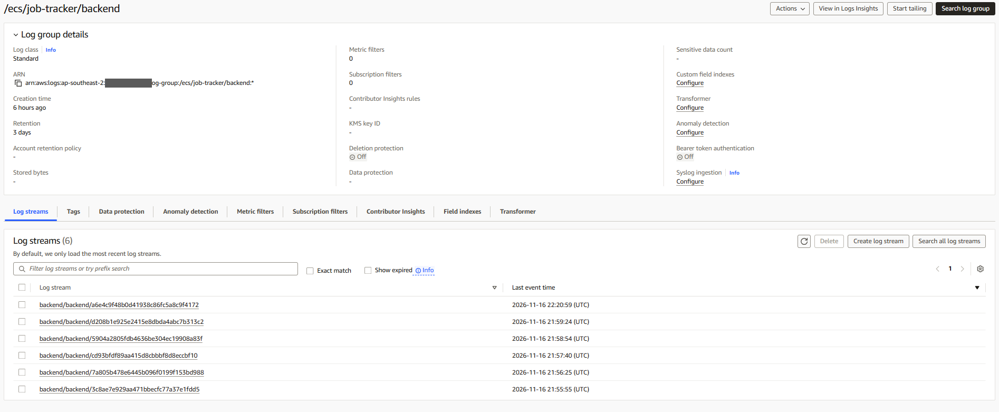 | 3-day retention; 5 failed streams then 1 healthy one: the circuit breaker at work |

## Cost

| Item | Approx. cost (ap-southeast-2) |
|---|---|
| Foundation layer | $0 |
| ECR storage (2 images, ~150 MB) | ~$0.015/month |
| Runtime layer while running (NAT instance, RDS db.t4g.micro, ALB, 2 Fargate Spot tasks) | **~$0.09/hour** |
| Same design always-on with a NAT Gateway | ~$110/month |
| The first deploy session, including debugging (~2.5 h) | ~$0.20–0.25 |

The savings come from: a NAT instance instead of a NAT Gateway, Fargate Spot, the smallest instance classes, single-AZ RDS, 3-day log retention, AWS-managed KMS keys, an ECR lifecycle policy, and destroying the runtime layer after each session.

## Known limitations and what I'd do for production

| Limitation (by design, for cost) | Production approach |
|---|---|
| HTTP only: no domain, so no TLS certificate on the ALB | Domain + free ACM certificate + 443 listener, with port 80 redirecting to 443 |
| Single NAT instance (single point of failure for outbound traffic) | NAT Gateway per AZ |
| Single-AZ RDS, automated backups off | Multi-AZ, backups and point-in-time recovery, deletion protection, RDS Extended Support explicitly managed |
| Fargate Spot | On-demand Fargate (or a mix) |
| Images pushed by script (OIDC blocked by the account guardrails) | CodeBuild/CodePipeline inside the account, or OIDC where allowed |
| No authentication; no WAF or alarms | Cognito, AWS WAF, CloudWatch alarms and dashboards |

---

## Run it locally

Requirements: Docker Desktop (running).

```bash
cp .env.example .env          # then set DB_PASSWORD
docker compose up --build
```

- App: http://localhost:3000
- API health: http://localhost:4000/api/health · DB check: http://localhost:4000/api/health/db
- Backend tests: `cd backend && npm test`

## Deploy to AWS

Requirements: Terraform ≥ 1.10, AWS CLI v2 signed in (`aws login`), Docker Desktop. Everything deploys to one Region (ap-southeast-2 by default).

```powershell
# 1. Foundation (free, one-time)
cd infra/foundation
terraform init
terraform apply

# 2. Build, scan and push images (prints the tag to deploy)
cd ../..
./scripts/push-images.ps1

# 3. Runtime (billable, ~10 min)
cd infra/runtime
terraform init
terraform apply -var="image_tag=<tag from step 2>"
terraform output app_url

# 4. Tear down when finished (stops billing)
terraform destroy -var="image_tag=<same tag>"
```

## API

| Method | Path | Description |
|---|---|---|
| GET | `/api/applications?status=` | List (optional status filter) |
| GET | `/api/applications/:id` | Get one |
| POST | `/api/applications` | Create (`company`, `role` required) |
| PATCH | `/api/applications/:id` | Update any fields |
| DELETE | `/api/applications/:id` | Delete |

Statuses: `wishlist`, `applied`, `interviewing`, `offer`, `rejected`.

## Repository layout

```
frontend/              Next.js app (standalone Docker image)
backend/               Express API, schema, validation, tests
infra/foundation/      Terraform: VPC, subnets, security groups, ECR, IAM, log groups
infra/runtime/         Terraform: NAT instance, RDS, ALB, ECS (create/destroy per session)
scripts/               push-images.ps1: build, push and scan images with short-lived credentials
.github/workflows/     CI: tests, builds, terraform fmt/validate (no AWS access)
docker-compose.yml     Local stack
```
